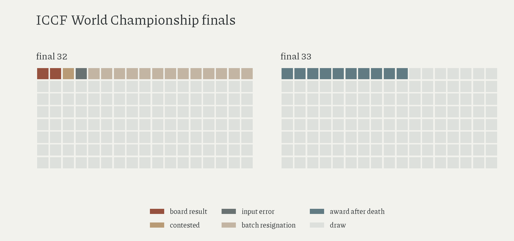

# outcomes in the two latest ICCF finals

Two of 272 games in finals 32 and 33 are classified as board results: Osipov's win against Schwetlick and Schwetlick's mating blunder against Lecroq, both in final 32.

| outcome | final 32 | final 33 |
|---|---:|---:|
| draw | 119 | 126 |
| batch resignation | 13 | 0 |
| contested resignation | 1 | 0 |
| input error | 1 | 0 |
| board result | 2 | 0 |
| award after death | 0 | 10 |

Jon Edwards's [interview and annotations](https://new.uschess.org/edwards-32nd-ICCF-ch) supply the final-32 circumstances: Bock resigned thirteen remaining games, Pessoa's resignation against Neto was disputed, and Michálek's loss followed an input error. The [game ledger](../data/curated/iccf_32_decisive_games.csv) reconciles all seventeen decisive scores with the player totals; the two board results remain separately labelled as a win and a mating blunder.

ICCF's [2024 commissioner's report](https://webfiles.iccf.com/congress/2024/reports/ICCF%20-%20Title%20Tournament%20Commissioner%20-%20Report%20-%20Congress%20-%202024.pdf) attributes final 33's ten decisive scores to Dronov's death; the final crosstable contains no further decisive results.

Final-32 labels describe participant-reported circumstances, without formal termination codes or independent resolution of the contested resignation. 'Two board results' is conditional on those labels: it cannot prove an absolute upper bound on wins through play or identify stronger engines as the cause of the draw rate.

[Claims C04](claims.md); [methods](methods.md#participation-and-outcomes).

Amended 16 October 2026: newly read literature; game-level outcome grids.
