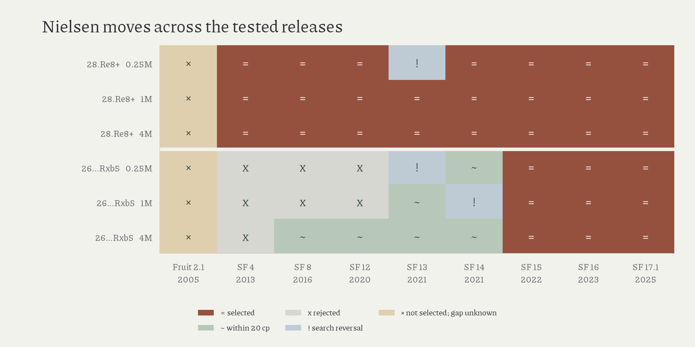

# Nielsen's moves across engine releases

Stockfish 15, released in 2022, is the first tested release selecting Nielsen's prepared 26...Rxb5 at all three budgets; 28.Re8+ first matches in tested SF4.

| move | first tested match at 250k, 1M, and 4M nodes | preceding tested release |
|---|---|---|
| 26...Rxb5 | SF15 (2022) | SF14 (2021) |
| 28.Re8+ | SF4 (2013) | Fruit 2.1 (2005) |

Every tested release through SF12 chooses another move at the Rxb5 position, although SF8 and SF12 score it near-equal at four million nodes; SF14's candidate gaps are +15, −75, and −16 centipawns across the three budgets; SF13 also reverses the unrestricted ranking at 250k.

For Re8+, SF13 disagrees at 250k and selects the move at both larger budgets. Later disagreement therefore prevents a first match from identifying a permanent transition; the untested early Stockfish releases also leave SF4's lower bracket open.

The fifty-four searches test two selected immediate positions with full histories; discovery several moves earlier is outside the comparison. Equal nodes imply unequal computation across releases; budget sensitivity replaces a sampling interval, and no number of years of human foresight is estimated. A non-selected Fruit move has an unknown candidate gap: its root restriction is ineffective.

[Search table](../data/derived/nielsen_releases.csv); [bench checks](../data/derived/engine_bench_checks.json); [methods](methods.md#engine-comparisons).

Amended 16 October 2026: newly read literature; selection separated from rejection.
