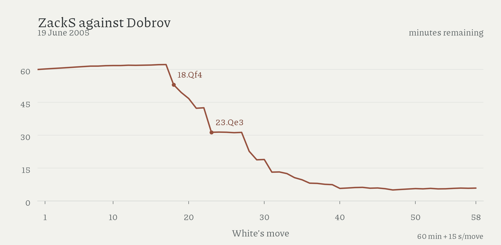

# human decisions in PAL/CSS 2005

ZackS saved about 25 minutes through move seventeen against Dobrov, then spent the advantage within six moves; Dobrov's later 33...Qc6 changed the evaluation at roughly level surviving clocks.

Stephen and Cramton's [account](https://en.chessbase.com/post/pal-c-report-from-the-dark-horse-s-mouth/9) describes three PCs, chiefly running Shredder 8 and Fritz 8; Stephen had already played over 10,000 engine games on Playchess. Against Dobrov, their first seventeen moves took two minutes: the next six included 9m27 on 18.Qf4 and 11m26 on 23.Qe3.

At 33...Qc6, ZackS had 12m28 and Dobrov at most 12m18. Shared searches at 4M/16M nodes give White expectation 0.851/0.6945 after ...Qc6, against 0.509/0.5045 after the preferred ...Qxb4.

Other interventions receive mixed support: Stockfish prefers the reported 23.h3 to the played Qe3 at every tested budget, and their 20.Qg2 in the earlier Dobrov game scores below fxe6. That game also followed published analysis which the players said they had not studied.

The missing Black time at 15...Kh8 makes Dobrov's remaining clock an upper bound; estimated advantages vary with search budget, and these participant-selected games cannot isolate live human value under equal equipment and preparation; ZackS never faced either Hydra entry in the supplied scores.

[Clock tables](../data/derived/pal_css_timing.csv), [symmetric turning-point searches](../data/derived/pal_css_2005_turning_points.csv), and [methods](methods.md#games-and-clocks) preserve the detailed checks; the uncalibrated search-speed scenarios remain outside the essay.

Amended 16 October 2026: newly read literature; clocks and decisive error selected for act 1.
