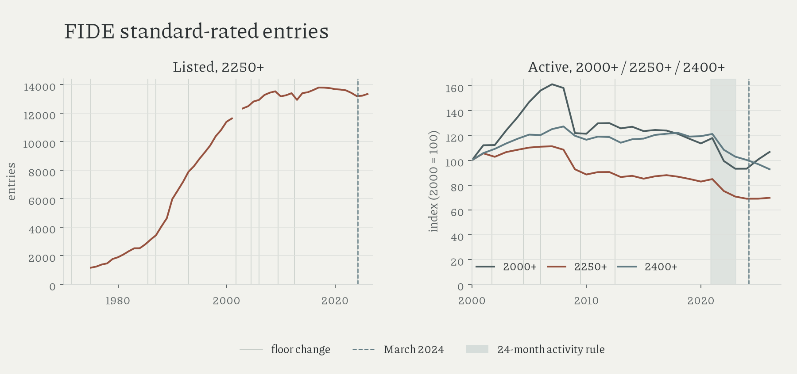

# January rated-list participation

Headline growth depends on definition: listed 2250+ entries rose from 9,733 to 13,344 between 1997 and 2026; active entries fell from 9,305 to 5,830 between 2007 and 2026; the threshold check gives a different result from a 2000 baseline: active 2000+ increased by 6.8%, while 2250+ fell 30.3% and 2400+ fell 7.2%.

| January | active 2000+ | active 2250+ | active 2400+ |
|---|---:|---:|---:|
| 2000 | 25,806 | 8,359 | 1,840 |
| 2007 | 41,634 | 9,305 | 2,303 |
| 2008 | 40,856 | 9,073 | 2,342 |
| 2009 | 31,466 | 7,754 | 2,204 |
| 2010 | 31,334 | 7,400 | 2,145 |
| 2026 | 27,553 | 5,830 | 1,707 |

All three thresholds decline between 2010 and 2026: 12.1%, 21.2%, and 20.4%, respectively, which weakens a decline confined to one rating boundary; it cannot separate rating deflation from fewer people playing rated games.

The 2250–2399 band accounts for nearly all of the 2250+ active decline over 2000–2026 (2,396 of 2,529 entries, 94.7%); no explanation has been found.

The 2008–09 identity bridge finds 1,790 previously active 2250+ players marked inactive, 583 still active below the threshold, and 52 missing; 1,105 enter or return above it, with one additional 2009 entry excluded for an ambiguous earlier ID. The January drop precedes the July 2009 changes documented in the activity-rule ledger; its exact implementation date remains unresolved.

Lichess's official monthly exports contain 436.8 million standard-rated games in 2019 and 1,181.3 million in 2023; 2024 falls to 1,113.2 million. These count games across time controls, without identifying unique players ([official index](https://database.lichess.org/#standard_games); [annual sums](../data/derived/online_standard_games.csv)).

Coverage and definitions limit these archive counts: 1972–74 are missing, 2002 membership is unresolved, and nominal ratings do not fix playing strength. Active status is unavailable before 2000; the COVID window changes from twelve to twenty-four months, then returns in January 2023. March 2024 remains a discontinuity. Awards stay separate; living titled players remain unavailable. [Methods](methods.md) retain source conflicts and duplicated IDs.

Amended 16 October 2026: headline growth qualified; the band comparison remains unexplained.
