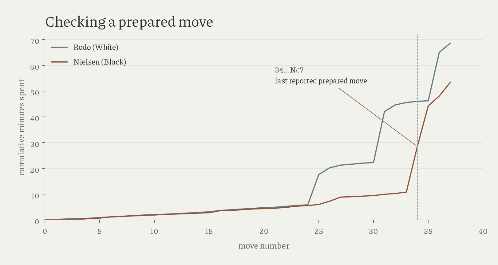

# preparation and clocks

Nielsen spent 17m40 checking his last prepared move, 34...Nc7, against Rodo in March 2007; a first long think therefore cannot identify where preparation ended.

His [account and annotations](https://en.chessbase.com/post/freestyle-che-teaching-an-engine-how-to-fly) describe comparing two alternatives during that pause: through move thirty-three, Rodo had spent 45.6 minutes and Nielsen 10.8; both clocks survive in the [move-time table](../data/derived/pal_css_move_times.csv).

Nielsen's 26...Rxb5 was prepared at home; he found 28.Re8+ against Averell during earlier calculation in that game. SF15 and SF4 are their respective first tested all-budget matches in the [release extension](nielsen-releases.md).

FIDE's [2021 game-four report](https://www.fide.com/fide-world-championship-dubai-2021-closing-window/) paraphrases Nepomniachtchi's claim that he recalled preparation throughout the draw; his first five-minute think came on move eighteen, after Carlsen's new idea; the report gives no direct transcript of the NRK exchange.

The surviving PAL/CSS finals show no consistent progression towards later first pauses. Different players and clocks, early-ending games, and missing move times constrain that comparison; preparation recollections are source claims, while a pause measures time use. The [account ledger](../data/curated/preparation_accounts.csv) keeps recalled bounds separate from observed pauses.

Amended 16 October 2026: newly read literature; superseded Nielsen first-match summary removed.
