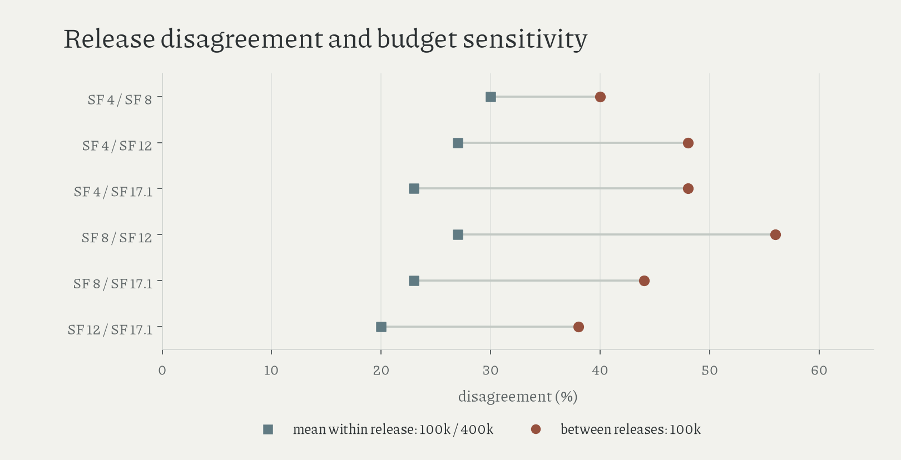

# revised engine advice

SF4 and SF17.1 selected the same move in 262/500 positions (52.4%, 95% game-bootstrap interval 47.8–56.6%); SF4's recommendation exceeded 0.02 judged expected-score loss in 87 positions.

Mean nonnegative losses under the common SF17.1 judge were 0.0236 for SF4 (95% interval 0.0180–0.0298), 0.0180 for SF8 (0.0127–0.0233), and 0.0097 for SF12 (0.0061–0.0142). Signed ranking reversals occurred in 37, 41, and 47 positions respectively.

The [noise-floor table](../data/derived/advice_noise_floor.csv) uses the same fifty presampled positions for every comparison: within-release agreement across 100k/400k nodes is 70% for SF4 and SF8, 76% for SF12, and 84% for SF17.1; the baseline below averages the two endpoint disagreement rates.

| releases | between-release agreement, 100k / 400k | mean budget disagreement | excess disagreement, 100k (95% paired interval) |
|---|---:|---:|---:|
| 4 / 8 | 60% / 64% | 30% | 10 points (−2–22) |
| 4 / 12 | 52% / 58% | 27% | 21 (9–34) |
| 4 / 17.1 | 52% / 54% | 23% | 25 (11–39) |
| 8 / 12 | 44% / 58% | 27% | 29 (16–41) |
| 8 / 17.1 | 56% / 58% | 23% | 21 (9–33) |
| 12 / 17.1 | 62% / 62% | 20% | 18 (5–31) |

The fifty-position excess is descriptive, without a measurement-error correction; its bootstrap intervals exclude uncertainty in unsearched alternatives. The 500-position sample is dominated by 2024 games, and the judge supplies estimated values, so these observations establish revised advice without measuring human learning or a knowledge half-life.

[Full agreement](../data/derived/advice_agreement.csv), [losses](../data/derived/advice_summary.csv), and [methods](methods.md#revised-advice-and-noise) retain the signed scores and frozen protocol, including the correction to Fruit's exclusion rationale.

Amended 16 October 2026: newly read literature; matched-position noise check.
